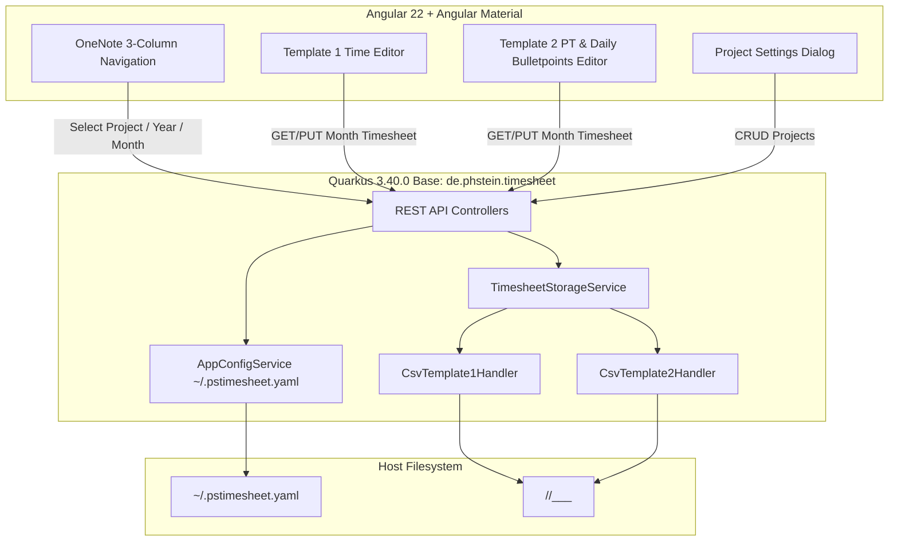

# Requirements

### Overview & Goals
PS-Timesheet is a lightweight, local-first time tracking web application. It combines a Quarkus (Java) REST backend with an Angular + Angular Material frontend, designed to run locally on the host machine.

Data storage is purely filesystem-based using human-readable CSV files and YAML/config files, organized hierarchically by project, year, and month. No external database or authentication system is required.

### Scope
- **In Scope:**
  - Backend in Quarkus 3.40.0 (Java 25, base package `de.phstein.timesheet`).
  - Frontend in Angular 22 with Angular Material.
  - User configuration loaded from `~/.pstimesheet.yaml` in the user's home directory.
  - Hierarchical file-system storage: `<basePath>/<yyyy>/<yyyy>_<MM>_<projectName>_<templateName>.csv` (Semicolon `;` separated, dot `.` decimal separator).
  - **WorkHours Template**: Daily start time, end time, pause duration, daily comment, and computed net duration.
  - **PersonDays Template**: Daily person-days (PT) per task (dynamic task columns per month, project defaults) and daily bulletpoint lists/notes per day.
  - OneNote-style multi-column layout: Projects column (`+ Projekt`), Years column (`+ Jahr`), Months column (`+ Monat`), and Main Timesheet Editor area.
  - Auto-navigation to current month on project selection, auto-creating directory structure and initialized CSV if not yet existing.
  - Auto-save on blur / debounced change in the frontend.
  - Local packaging: Quarkus serving Angular static assets directly on port 8080 when built for production.

- **Out of Scope:**
  - Docker containerization / Docker compose setups.
  - Multi-user authentication / authorization (single-user local-first operation).
  - External SQL/NoSQL databases.
  - Cloud synchronization / remote storage backends.

### User Stories
- **US1**: As a user, I want to manage my time-tracking projects in a central YAML config file (`~/.pstimesheet.yaml`) with specific base storage paths and templates so that my project structure is clean and portable.
- **US2**: As a user, I want a OneNote-like navigation pane with Projects, Years, and Months so that I can quickly switch between periods and projects.
- **US3**: As a user, I want the WorkHours template to record exact start/end times and pause durations per day and view total working hours per day and month.
- **US4**: As a user, I want the PersonDays template to track person-days (PT) per task per day, customize tasks per month, and record daily bulletpoint lists per day to document detailed accomplishments efficiently.
- **US5**: As a user, I want missing year folders and month CSVs to be created automatically when navigating so that I can start tracking immediately without manual file creation.
- **US6**: As a user, I want to start the application easily on my local machine via standard Java / Maven tooling.

### Functional Requirements
- **FR1 (Config Management)**: On startup, read `~/.pstimesheet.yaml`. If not present, create a default template configuration. Provide API endpoints to read and update project configurations.
- **FR2 (Directory & CSV Scanning)**: Scan configured project `basePath` directories for subdirectories matching 4-digit years (`<yyyy>`) and files matching `<yyyy>_<MM>_<projectName>_<templateName>.csv`.
- **FR3 (Auto-Creation)**: Selecting a project navigates to current year/month. If the year folder or month CSV does not exist, initialize it with all calendar days of that month (1..lastDay) and header row.
- **FR4 (WorkHours Template Processing)**:
  - Columns: `Date`, `DayOfWeek`, `StartTime` (`HH:mm`), `EndTime` (`HH:mm`), `PauseMinutes` (`int`), `Comment` (`text`).
  - Calculate daily net hours (`(EndTime - StartTime) - Pause`) and monthly totals dynamically on the fly (not persisted as a separate CSV column).
- **FR5 (PersonDays Template Processing)**:
  - Dynamic task columns: `Date`, `DayOfWeek`, `<Task 1>`, `<Task 2>`, ..., `<Task N>`, `Notes`.
  - Monthly task defaults loaded from project config; month CSV columns define actual month tasks.
  - Calculate daily total PT (sum across task columns) and monthly totals dynamically on the fly (not persisted as a separate CSV column).
  - Daily bullet points / notes stored in a dedicated `Notes` column for each day row (multiline text with bullet formatting properly quoted in CSV).
- **FR6 (OneNote-Style UI)**:
  - 3-column navigation: Column 1 (Projects), Column 2 (Years with CSVs + `+ Jahr`), Column 3 (Months with CSVs + `+ Monat`).
  - Main area displaying the active timesheet grid with real-time row totals and column totals.
  - Highlight weekends (Saturday, Sunday) visually.
  - Auto-save on blur / debounced change with status indicator.

### Non-Functional Requirements
- **Performance**: Instant file scan and page load (<100ms for monthly CSV operations).
- **Extensibility**: Pluggable template architecture allowing addition of new templates (`TemplateHandler` interface).
- **Portability**: Runs on Linux, macOS, and Windows via local JVM.

# Technical Design

### Current Implementation
The repository currently contains the OpenSpec project structure and configuration, ready for the implementation of the PS-Timesheet backend and frontend modules.

### Key Decisions
1. **Quarkus Static Resource Serving for Production**:
   - *Decision*: In production build, bundle the Angular distribution directly into Quarkus `META-INF/resources`.
   - *Rationale*: Allows running the entire application as a single standard Java process listening on port 8080 without requiring reverse proxies or separate web servers.
2. **Template 2 Daily Bulletpoint Notes in CSV Row**:
   - *Decision*: Store daily bullet points/notes directly in a dedicated `Notes` column in each day row of the monthly CSV (properly quoted with standard CSV multiline escaping).
   - *Rationale*: Eliminates detached file-level blocks, keeping daily task allocations and their corresponding bullet points aligned in the exact same tabular record for maximum utility and clarity.
3. **YAML Configuration File (`~/.pstimesheet.yaml`)**:
   - *Decision*: Store user settings and project definitions in YAML format inside `~/.pstimesheet.yaml`.
   - *Rationale*: Human-friendly syntax for nested project lists, base paths, and task lists.
4. **Pluggable Template Architecture**:
   - *Decision*: Backend defines `TimesheetTemplateHandler` interface implemented by `CsvTemplate1Handler` and `CsvTemplate2Handler`.
   - *Rationale*: Seamlessly accommodates future templates without altering core file-scanning or REST endpoint routing.

### Proposed Architecture & Flow



### Data Models & Contracts

#### 1. Configuration (`~/.pstimesheet.yaml`)
```yaml
projects:
  - name: "Blubb"
    basePath: "/Users/user/timesheets/Blubb"
    template: "Temp1"
  - name: "ProjectAlpha"
    basePath: "/Users/user/timesheets/ProjectAlpha"
    template: "Temp2"
    defaultTasks:
      - "Konzeption"
      - "Entwicklung"
      - "Review & Test"
```

#### 2. CSV Schema - Template 1 (`2025_03_Blubb_Temp1.csv`)
```csv
Date;DayOfWeek;StartTime;EndTime;PauseMinutes;Comment
2025-03-01;Samstag;;;;
2025-03-02;Sonntag;;;;
2025-03-03;Montag;08:30;17:00;30;Architektur Meeting & Setup
2025-03-04;Dienstag;09:00;17:30;45;Feature Implementation
```

#### 3. CSV Schema - Template 2 (`2025_03_ProjectAlpha_Temp2.csv`)
```csv
Date;DayOfWeek;Konzeption;Entwicklung;Review & Test;Notes
2025-03-01;Samstag;;;;
2025-03-02;Sonntag;;;;
2025-03-03;Montag;0.25;0.75;;"- Meilenstein 1 erfolgreich abgeschlossen
- Deployment vorbereitet"
2025-03-04;Dienstag;;0.8;0.2;"- Bugfix im Backend"
```

#### 4. REST Endpoints
- `GET /api/config` -> `AppConfigDTO`
- `GET /api/projects` -> `List<ProjectDTO>`
- `POST /api/projects` -> Create / Update project in config
- `GET /api/timesheets/{project}/tree` -> Hierarchical list of existing years and months
- `GET /api/timesheets/{project}/{year}/{month}` -> `TimesheetMonthDTO` (auto-creates if missing)
- `PUT /api/timesheets/{project}/{year}/{month}` -> Save `TimesheetMonthDTO`

### File Structure
```
ps-timesheet/
├── backend/
│   ├── src/main/java/de/phstein/timesheet/
│   │   ├── config/ (AppConfigService, ProjectConfig, AppConfig)
│   │   ├── model/ (TimesheetDay, TimesheetMonth, ProjectDTO, etc.)
│   │   ├── service/ (TimesheetStorageService, TemplateHandler, CsvTemplate1Handler, CsvTemplate2Handler)
│   │   └── rest/ (ProjectResource, TimesheetResource, ConfigResource)
│   ├── src/main/resources/
│   │   └── application.properties
│   └── pom.xml
├── frontend/
│   ├── src/app/
│   │   ├── components/
│   │   │   ├── navigation/ (OneNote 3-column navigation)
│   │   │   ├── template1-editor/ (Time grid editor)
│   │   │   ├── template2-editor/ (PT & task columns + notes editor)
│   │   │   └── project-dialog/ (Project config modal)
│   │   ├── models/ (project.model.ts, timesheet.model.ts)
│   │   └── services/ (timesheet-api.service.ts, timesheet-state.service.ts)
│   ├── angular.json
│   └── package.json
└── README.md
```

### Risks & Mitigations
- **Concurrent File Access**: Local-first app with single user; backend uses atomic file writes (write to temporary file then replace) to avoid corrupted CSVs on unexpected termination.
- **Dynamic Task Columns in Template 2**: Changing task names for a month must safely update CSV header without losing row data; handled through key-based column mapping.
- **File System Permissions**: App verifies read/write permissions on configured base paths and produces clear, actionable error messages in the UI if paths are inaccessible.

# Testing

### Validation Approach
Automated testing in both backend and frontend layers combined with local end-to-end flow validation.

### Key Scenarios
1. **Startup & Config Loading**:
   - App boots with missing `~/.pstimesheet.yaml` -> initializes default config file.
   - App boots with existing `~/.pstimesheet.yaml` -> parses project base paths and template definitions accurately.
2. **Auto-Creation of Year Folders and Month CSVs**:
   - Selecting a project with no existing records for the current month -> creates `<basePath>/<yyyy>/` directory and pre-populates `<yyyy>_<MM>_<projectName>_<templateName>.csv` with all calendar days.
3. **Template 1 Time Calculation & Persistence**:
   - Enter `08:00` start, `17:00` end, `60` min pause -> net hours calculated dynamically as `8.0` without storing NetHours in the CSV file.
   - Update comment and save -> verifies CSV file on disk matches expected format (`Date;DayOfWeek;StartTime;EndTime;PauseMinutes;Comment`).
4. **Template 2 Task Columns & Daily Bulletpoints**:
   - Configure tasks `A` and `B` -> enter `0.5` on `A` and `0.5` on `B` -> day total dynamically calculated as `1.0` without storing Total_PT in the CSV file.
   - Add new task `C` for the month -> CSV header adds column `C` while preserving existing `A` and `B` values.
   - Enter daily bulletpoints -> verifies multiline quoted CSV cells are saved and parsed accurately per day in the `Notes` column.
5. **OneNote-Style Navigation**:
   - Switching between projects dynamically updates available years and months list.
   - Clicking `+ Projekt`, `+ Jahr`, `+ Monat` creates respective items and immediately focuses them in the UI.

### Edge Cases
- **Leap Years & Month Lengths**: Correctly handles February 28/29, 30-day, and 31-day months.
- **Corrupted / Empty CSV Files**: Graceful error handling and backup file creation if a CSV contains malformed rows.
- **Special Characters in Comments / Daily Bulletpoints**: Escaping semicolons, quotes, and newlines in CSV cells.

### Test Changes
- `AppConfigServiceTest`: Unit tests for config loading, serialization, and path expansion.
- `CsvTemplate1HandlerTest` & `CsvTemplate2HandlerTest`: Unit tests for CSV parsing, writing, date generation, dynamic task columns, and daily multiline bulletpoint notes.
- `TimesheetResourceTest`: Quarkus integration tests (`@QuarkusTest`) verifying REST endpoints.
- Angular component unit tests for navigation, Template 1 calculation, and Template 2 dynamic columns.

# Delivery Steps

### ✓ Step 1: Quarkus Backend Foundation, Configuration & File-System Storage Layer
The Quarkus backend starts up locally with configuration management, user-directory lookup, and path resolution for timesheet projects.

- Initialize the Quarkus 3.40.0 application structure with Java 25, base package `de.phstein.timesheet`, and dependencies (`quarkus-rest-jackson`, `jackson-dataformat-yaml`, `opencsv` / `commons-csv`).
- Implement `AppConfigService` to locate and load `~/.pstimesheet.yaml` (with fallback to `~/.pstimesheet.config` and environment override `PSTIMESHEET_CONFIG_PATH`).
- Define the configuration data model supporting project entries with `name`, `basePath`, `template` (`Temp1` | `Temp2`), and default `tasks` list.
- Provide CRUD REST endpoints in `ProjectResource` and `ConfigResource` (`GET /api/projects`, `POST /api/projects`, `PUT /api/projects/{name}`, `GET /api/config`).
- Add unit tests for config parsing, default creation, and path expansions.

### ✓ Step 2: Timesheet Data Engine & REST API for Template 1 and Template 2
The backend scans existing year/month CSV files, auto-creates missing month CSVs on access, and supports reading/writing of Template 1 and Template 2 timesheet data.

- Implement `TimesheetStorageService` to list existing years and month CSVs matching `<basePath>/<yyyy>/<yyyy>_<MM>_<projectName>_<templateName>.csv`.
- Implement `CsvTemplate1Handler` for daily tracking of start time, end time, pause duration, and daily comments with semicolon delimiter and dot decimal separator; calculate daily net hours dynamically.
- Implement `CsvTemplate2Handler` for daily task person-days (PT), dynamic task columns per month, monthly task overrides, and daily bulletpoint list parsing/writing in the `Notes` column; calculate total PT per day and month dynamically.
- Implement `TimesheetResource` (`GET /api/timesheets/{project}/{year}/{month}`, `PUT /api/timesheets/{project}/{year}/{month}`, `GET /api/timesheets/{project}/years-months`).
- Implement auto-creation logic: when accessing a project/year/month without an existing CSV, generate the folder structure and initialize the CSV pre-populated with all days of the month.
- Add integration tests verifying CSV parsing, calculation, and file persistence.

### ✓ Step 3: Angular Frontend Architecture & OneNote-Style Navigation Layout
The Angular frontend renders a 3-column OneNote-style navigation hierarchy (Projects, Years, Months) with action buttons and reactive selection state.

- Set up Angular 22 with Angular Material, SCSS styling, and standalone components structure.
- Build the `TimesheetNavigationComponent` featuring three collapsible/resizable navigation columns:
  - Left column: Configured projects list with active indicator and `+ Projekt` action.
  - Middle column: Available years for selected project with `+ Jahr` action.
  - Right column: Available months for selected year with `+ Monat` action.
- Implement `TimesheetStateService` using Angular Signals / RxJS to manage active project/year/month selection and trigger auto-loading / auto-creation.
- Implement `ProjectDialogComponent` to add/edit projects, choose templates, set base paths, and configure default tasks.
- Add component tests for navigation selection and dialog actions.

### ✓ Step 4: Timesheet Editors for Template 1, Template 2 & Dynamic Task Management
Users can view, edit, and save timesheet entries for both Template 1 and Template 2 with real-time validations, sums, and note management.

- Implement `Template1EditorComponent` with an editable Material table for days 1..N:
  - Inputs for `StartTime`, `EndTime`, `Pause (min)`, `Comment`.
  - Dynamic calculation of daily net hours and total monthly sum.
  - Visual distinction for weekends (Saturday, Sunday) and empty rows.
- Implement `Template2EditorComponent` with dynamic task columns for daily person-days (PT):
  - Dynamic column rendering based on month's task list with dynamically calculated total PT per day and per task.
  - Dynamic task management controls to add, rename, or remove task columns for the active month.
  - Daily bulletpoint / notes editor per day row with expand/collapse or inline list input, stored in the day's record.
- Add debounced auto-save on blur/change with clear visual saving indicator.
- Add unit tests for calculation logic and dynamic column manipulation.

### ✓ Step 5: Frontend & Backend Integration, Build & Packaging
The Angular frontend is built and served directly by Quarkus, supporting both seamless local development and production single-binary distribution.

- Configure Maven build (e.g. `frontend-maven-plugin`) to build the Angular application and copy production assets into `backend/src/main/resources/META-INF/resources`.
- Implement SPA routing fallback in Quarkus to route deep frontend URLs to `index.html`.
- Verify local development workflow: running Quarkus backend (`mvn quarkus:dev`) and Angular dev server (`ng serve` with proxy) simultaneously.
- Verify production package build (`mvn clean package`) and execution via `java -jar`.
- Write README documentation explaining local setup, configuration options, and running the application.